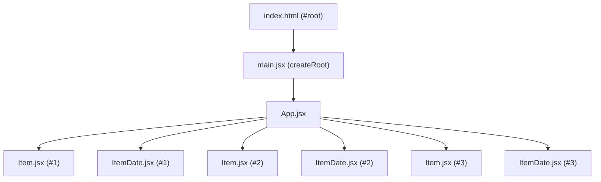

# Source Directory (`src`) Documentation

This directory houses the core application code for the **DemoShopApp** React project built with Vite.

---

## 📁 Directory Structure

```text
src/
├── assets/                  # Static assets (images, SVGs)
│   ├── hero.png
│   ├── react.svg
│   └── vite.svg
├── components/              # Modular, reusable React components
│   ├── Item.css             # Styles for the Item component
│   ├── Item.jsx             # Displays an item label
│   ├── ItemDate.css         # Styles for the ItemDate component
│   └── ItemDate.jsx         # Displays day, month, and year values
├── App.css                  # Styles for the root App component
├── App.jsx                  # Main application component & layout
├── index.css                # Global stylesheet
├── main.jsx                 # Application entry point & DOM root mount
├── notes.md                 # Detailed concepts & study notes for this step
└── readme.md                # Source directory documentation
```

---

## 🧩 Component Architecture

The application demonstrates component composition where smaller, focused UI elements are assembled into larger views.



---

## 📜 File Breakdown

### Entry Point & Layout
- **[main.jsx](file:///c:/Personal/Code/React2/DemoShopApp/src/main.jsx)**:
  Initializes React with `createRoot(document.getElementById('root'))` and renders `<App />` wrapped in `<StrictMode>`.
- **[App.jsx](file:///c:/Personal/Code/React2/DemoShopApp/src/App.jsx)**:
  Acts as the parent layout container. Imports and displays multiple instances of `Item` and `ItemDate`.
- **[App.css](file:///c:/Personal/Code/React2/DemoShopApp/src/App.css)**:
  Contains styles for the container element in `App.jsx`.

### Components (`src/components/`)
- **[Item.jsx](file:///c:/Personal/Code/React2/DemoShopApp/src/components/Item.jsx)**:
  A functional component returning a paragraph element styled with `para` class from `Item.css`.
- **[Item.css](file:///c:/Personal/Code/React2/DemoShopApp/src/components/Item.css)**:
  Specifies font size, alignment, and background color for `Item`.
- **[ItemDate.jsx](file:///c:/Personal/Code/React2/DemoShopApp/src/components/ItemDate.jsx)**:
  A functional component declaring date variables (`day`, `month`, `year`) and rendering them inside `<span>` tags.
- **[ItemDate.css](file:///c:/Personal/Code/React2/DemoShopApp/src/components/ItemDate.css)**:
  Applies styles to `.mfg-date` container.

---

## 🚀 Running the Project

From the `DemoShopApp` directory:

```bash
# 1. Install dependencies (if not already installed)
npm install

# 2. Start the Vite development server
npm run dev

# 3. Build for production
npm run build

# 4. Preview the production build locally
npm run preview
```

---

## 📚 Study Notes
For a comprehensive breakdown of React concepts used here (JSX rules, component lifecycle, rendering expressions, and upcoming topics like Props & State), refer to:
- **[notes.md](file:///c:/Personal/Code/React2/DemoShopApp/src/notes.md)**
