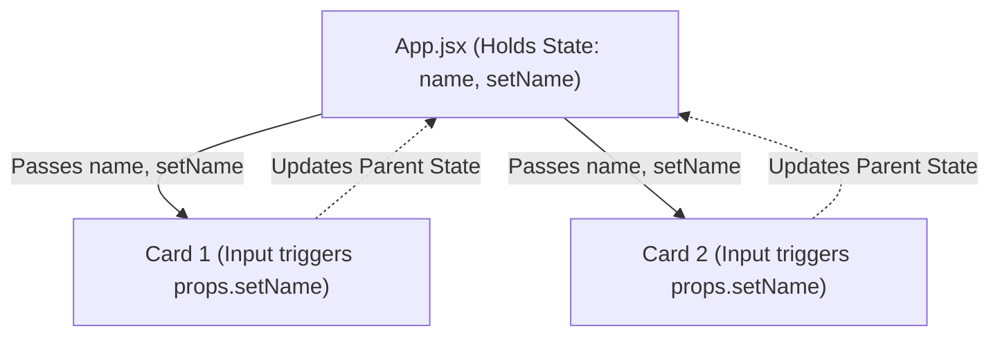
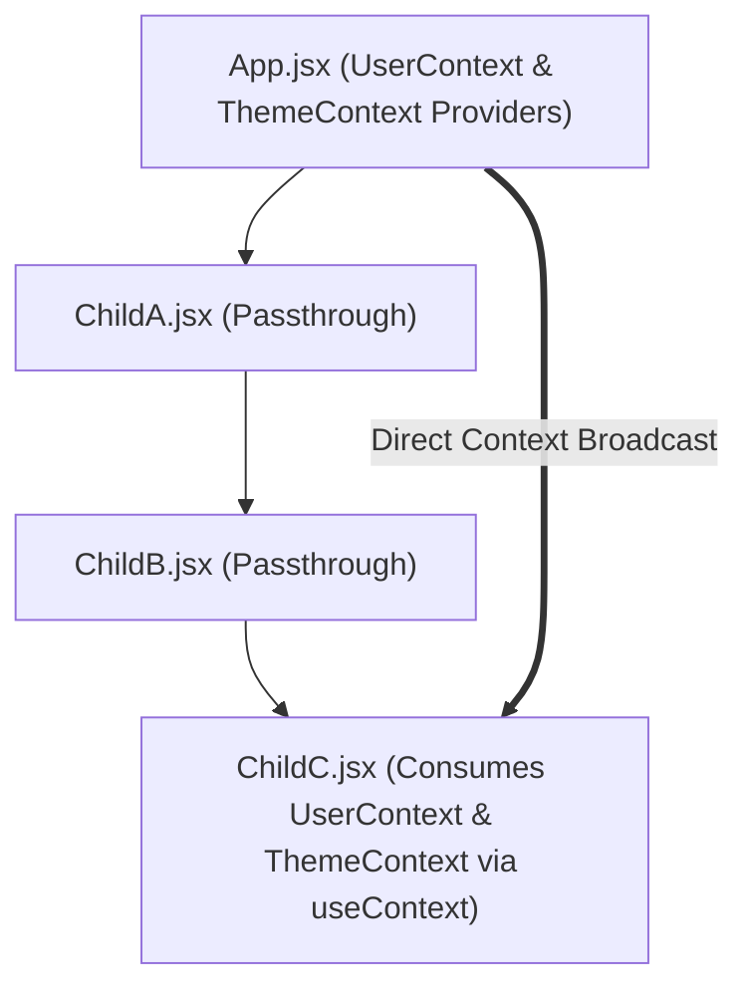
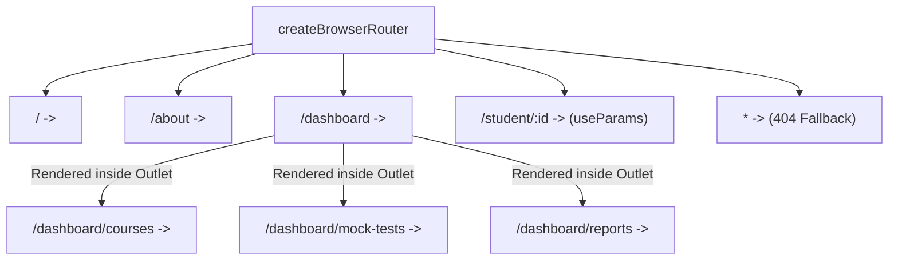

# React 2.0 Comprehensive Study Handbook

A structured, in-depth reference documenting core React concepts, architectural patterns, hooks, and best practices across modular practice projects.

---

## 📚 Table of Contents
- [📌 Module 1: React Setup & Architecture (`01react`)](#-module-1-react-setup--architecture-01react)
- [📌 Module 2: Components, Props & Assets (`02comps-props-jsx`)](#-module-2-components-props--assets-02comps-props-jsx)
- [📌 Module 3: State Management with `useState` (`03usestate-hook`)](#-module-3-state-management-with-usestate-03usestate-hook)
- [📌 Module 4: Advanced Props — Children & Function Props (`04props-extra`)](#-module-4-advanced-props--children--function-props-04props-extra)
- [📌 Module 5: State Lifting & Sibling Synchronization (`05state-lifting`)](#-module-5-state-lifting--sibling-synchronization-05state-lifting)
- [📌 Module 6: Conditional Rendering Patterns (`06conditional-rendering`)](#-module-6-conditional-rendering-patterns-06conditional-rendering)
- [📌 Module 7: Event Handling & Synthetic Events (`07event-handling`)](#-module-7-event-handling--synthetic-events-07event-handling)
- [📌 Module 8: The `useEffect` Hook & Lifecycle Management (`08useEffect-hook`)](#-module-8-the-useeffect-hook--lifecycle-management-08useeffect-hook)
- [📌 Module 9: The Context API & `useContext` Hook (`09useContext-hook`)](#-module-9-the-context-api--usecontext-hook-09usecontext-hook)
- [📌 Module 10: Client-Side Routing with React Router (`10react-router`)](#-module-10-client-side-routing-with-react-router-10react-router)
- [📊 Summary of Concepts Across Modules](#-summary-of-concepts-across-modules)

---

## 📌 Module 1: React Setup & Architecture (`01react`)

### 1. Bootstrapping & Mounting with Vite
- **`index.html`**: The single HTML page containing the root element `<div id="root"></div>`.
- **`main.jsx`**: The application entry point. React 18+ uses `createRoot` from `react-dom/client`:
   ```jsx
   import { createRoot } from 'react-dom/client'
   import './index.css'
   import Navbar from './components/Navbar.jsx'

   createRoot(document.getElementById('root')).render(
     <Navbar />
   )
   ```
   - `createRoot(...)`: Creates the root DOM container.
   - `.render(<Navbar />)`: Injects and renders the component into the browser DOM.

### 2. Declaring Functional Components
- **Arrow Function Component** (`src/components/Navbar.jsx`):
  ```jsx
  const Navbar = () => {
    return (
      <div>
          <div>I am Navbar!</div>
      </div>
    )
  }
  export default Navbar
  ```
- **Standard Function Component** (`src/App.jsx`):
  ```jsx
  import './App.css';
  function App() {
    return (
      <>
        <p>Hello My name is React!</p>
      </>
    )
  }
  export default App
  ```

### 3. JSX & React Fragments (`<>...</>`)
- Every component must return a **single root element**.
- When you do not want to add an unnecessary extra wrapper `<div>` to the real DOM, use **React Fragments** (`<> ... </>`).

### 4. Styling Layers
- **Global CSS (`index.css`)**: Imported once in `main.jsx` for universal margin/padding reset (`* { margin: 0; padding: 0; box-sizing: border-box; }`) and viewport flex centering on `body`.
- **Component CSS (`App.css`)**: Imported directly into the component file (`import './App.css'`) for targeted styles.

---

## 📌 Module 2: Components, Props & Assets (`02comps-props-jsx`)

### 1. What are Props?
- **Props (Properties)** are arguments passed into React components from their parent.
- Data flows **one-way (unidirectional)**: from Parent (`App.jsx`) down to Child (`UserCard.jsx`).
- Props are **read-only (immutable)** inside the child component.

### 2. Passing Props from Parent (`App.jsx`)
```jsx
import UserCard from './components/UserCard'
import './App.css'
import ZoroPic from "./assets/Zoro.jpg";
import MikeyPic from "./assets/Mikey.jpg";
import GutsPic from "./assets/Guts.jpg";

function App() {
  return (
    <div className='container'>
      <UserCard name="Zoro" desc="desc1" image={ZoroPic} style={{"border-radius": "10px"}}/>
      <UserCard name="Mikey" desc="desc2" image={MikeyPic} style={{"border-radius": "10px"}}/>
      <UserCard name="Guts" desc="desc3" image={GutsPic} style={{"border-radius": "10px"}}/>
    </div>
  )
}

export default App
```

### 3. Receiving and Consuming Props (`UserCard.jsx`)
```jsx
import './UserCard.css';

const UserCard = (props) => {
  return (
    <div className='user-container' style={props.style}>
        <p id='user-name'>{props.name}</p>
        
        <p id='user-desc'>{props.desc}</p>
    </div>
  )
}

export default UserCard
```

### 4. Key Techniques in Module 2
- **Importing Local Assets**: Image files in `src/assets/` are imported as JavaScript variables (`import ZoroPic from "./assets/Zoro.jpg"`) and passed as prop values (`image={ZoroPic}`).
- **Passing Inline Style Objects**: React accepts JavaScript style objects with camelCase/quoted CSS properties (`style={{"border-radius": "10px"}}`), rendered via `style={props.style}`.

---

## 📌 Module 3: State Management with `useState` (`03usestate-hook`)

### 1. Why Normal Variables Don't Work
Regular JavaScript variables (e.g. `let count = 0; count++;`) update the variable in memory, but **do not tell React to re-render the UI**. React cannot know when to refresh the screen.

### 2. The `useState` Hook
State is data that, when changed, causes React to **re-render** the component with updated values.

```jsx
import { useState } from 'react'
import './Counter.css'

const Counter = () => {
    // 1. Declare state variable and setter function
    const [count, setCount] = useState(0);

    return (
      <div className="counter-container">
          <p id='para'>You have clicked {count} times.</p>
          {/* 2. Update state via setter on user interaction */}
          <button id='btn' onClick={() => { setCount(count + 1) }}>
              Click Me
          </button>
      </div>
    )
}

export default Counter
```

### 3. Anatomy of `useState`
- `count`: The current state value.
- `setCount`: The updater function used to modify state.
- `useState(0)`: Sets the initial value (`0`).
- **`onClick={() => setCount(count + 1)}`**: Event listener passed as an arrow function that triggers state update upon button click.

---

## 📌 Module 4: Advanced Props — Children & Function Props (`04props-extra`)

### Pattern 1: Passing Props as Children (`props.children`)
`props.children` allows creating **Wrapper / Container components** that render whatever nested elements are placed between their opening and closing tags.

```jsx
// Wrapper Component (Card.jsx)
const Card = (props) => {
  return <div>{props.children}</div>
}

// Usage in App.jsx
<Card name="Santosh Pant">
    <h1>Best Web Dev Course</h1>
    <p>Trying to be consistent in this</p>
</Card>
```

### Pattern 2: Passing Functions as Props (Callback Props)
To allow child components to trigger state changes in the parent, the parent passes down a callback function as a prop:

```jsx
// Parent (App.jsx)
function App() {
  const [count, setCount] = useState(0)
  function handleClick() { setCount(count + 1); }

  return (
    <Button incrementCount={handleClick} text="Click Me">
      <h1>{count}</h1>
    </Button>
  )
}

// Child (Button.jsx)
const Button = (props) => {
  return (
    <div>
        {props.children}
        <button onClick={props.incrementCount}>
            {props.text} 
        </button>
    </div>
  )
}
```

---

## 📌 Module 5: State Lifting & Sibling Synchronization (`05state-lifting`)

### 1. The Concept of Lifting State Up
In React, components can only pass props downwards (parent to child). Two sibling components cannot directly communicate or share state horizontally.
When two or more sibling components need to reflect the same changing data, you must **lift the state up** to their closest common ancestor.

### 2. Implementation Architecture
- **Common Parent (`App.jsx`)**: Declares and manages the `name` state and `setName` updater function.
- **Child Components (`Card.jsx`)**: Siblings that receive both `name` and `setName` as props.



### 3. Code Walkthrough

#### Parent Component (`src/App.jsx`):
```jsx
import Card from "./components/Card"
import { useState } from "react"

function App() {
  // 1. Create and manage state in the closest common parent
  const [name, setName] = useState('');

  return (
   <div>
    {/* 2. Pass state variable AND setter function to both sibling children */}
    <Card title="Card 1" name={name} setName={setName}/>
    <Card title="Card 2" name={name} setName={setName}/>
   </div>
  )
}

export default App
```

#### Child Component (`src/components/Card.jsx`):
```jsx
const Card = (props) => {
  return (
    <div>
        {/* Calling props.setName updates the state in App.jsx */}
        <input type="text" onChange={(e) => props.setName(e.target.value)} />
        <p>Name state variable value inside the {props.title}: {props.name}</p>
    </div>
  )
}

export default Card
```

### 4. Key Takeaways
- **Single Source of Truth**: State exists in only one place (`App.jsx`).
- **Synchronized UI**: Typing into the input of `Card 1` invokes `props.setName(e.target.value)`, causing `App` to re-render and immediately sync the text inside `Card 2` and vice versa.

---

## 📌 Module 6: Conditional Rendering Patterns (`06conditional-rendering`)

Conditional rendering in React allows rendering different elements or components based on certain state or prop conditions.

### The 4 Core Patterns Demonstrated in `06conditional-rendering`

#### Pattern 1: Early Return
Exits early from the component function before rendering the rest of the template:
```jsx
if (!isLoggedIn) {
  return <LoginBtn />
}

return (
  <div>
    <h1>Welcome to React Learning!</h1>
    <LogoutBtn />
  </div>
)
```

#### Pattern 2: Logical AND (`&&`) Short-Circuit Operator
Renders the element on the right side if and only if the left-hand condition evaluates to truthy:
```jsx
<div>
  <h1>Welcome to React Learning!</h1>
  {isLoggedIn && <LogoutBtn />}
</div>
```

#### Pattern 3: Ternary Operator (`condition ? A : B`)
Ideal for inline binary choices directly within JSX:
```jsx
<div>
  {isLoggedIn ? <LogoutBtn /> : <LoginBtn />}
</div>
```

#### Pattern 4: Classic `if-else` Block
```jsx
if (isLoggedIn) {
  return <LogoutBtn />
} else {
  return <LoginBtn />
}
```

### Summary Comparison of Conditional Patterns:
| Pattern | Syntax | Best Use Case |
| :--- | :--- | :--- |
| **Early Return** | `if (!cond) return <Fallback />` | Guard clauses, loading screens, permission denials |
| **Logical `&&`** | `{cond && <Element />}` | When you want to render something or nothing |
| **Ternary Operator** | `{cond ? <A /> : <B />}` | Clean inline toggles between two elements |
| **`if-else`** | `if (cond) { return A } else { return B }` | Complex branching logic with distinct layout trees |

---

## 📌 Module 7: Event Handling & Synthetic Events (`07event-handling`)

React wraps native browser DOM events in a cross-browser wrapper called **`SyntheticEvent`**. It normalizes event behaviors so they behave consistently across Chrome, Safari, Firefox, and Edge.

### 1. Patterns Implemented in `App.jsx`

#### Pattern A: Inline Arrow Function
Useful for simple, single-statement actions:
```jsx
<button onClick={() => alert("Button is clicked")}>
  Click Me  
</button>
```

#### Pattern B: Passing Function Reference
Pass the function name **without calling it** (no parentheses):
```jsx
function clickHandler() {
  alert("I am clicked!");
}

// Correct: passed as a reference
<button onClick={clickHandler}>Click me</button>

// WRONG: <button onClick={clickHandler()}> -> Executes immediately on render!
```

#### Pattern C: Mouse Events (`onMouseOver`)
```jsx
function mouseOver() {
  alert("Mouse is over the paragraph.");
}

<p onMouseOver={mouseOver} style={{ border: "1px solid black" }}>
  I am a Paragraph.
</p>
```

#### Pattern D: Input Events & `e.target.value`
Accesses the synthetic event object `e` to track user keystrokes in real time:
```jsx
function inputChangeHandler(e) {
  console.log("Value till now: ", e.target.value);
}

<input type="text" onChange={inputChangeHandler} />
```

#### Pattern E: Form Submission & `e.preventDefault()`
Prevents the browser from performing its default behavior (reloading the entire web page upon form submit):
```jsx
function submitHandler(e) {
  e.preventDefault(); // Halts default browser page refresh
  alert("Should I submit?");
}

<form onSubmit={submitHandler}>
  <input type="text" onChange={inputChangeHandler} />
  <button type="submit">Submit</button>
</form>
```

---

## 📌 Module 8: The `useEffect` Hook & Lifecycle Management (`08useEffect-hook`)

### 1. What are Side Effects?
Operations that interact with the outside world or execute outside React's pure rendering flow:
- Fetching data from an external REST API.
- Subscribing to browser events (window resize, scroll).
- Setting and clearing timers (`setInterval`, `setTimeout`).
- Direct DOM manipulation or console logging.

### 2. Anatomy of `useEffect`
```jsx
useEffect(() => {
    // 1. Setup / Side-effect logic runs here
    
    return () => {
        // 2. Cleanup logic runs before next effect execution or component unmount
    };
}, [/* 3. Dependency array */]);
```

### 3. The 5 Core Variations / Dependency Rules

#### Variation 1: No Dependency Array
Runs after **every single render** (initial mount + every state/prop update):
```jsx
useEffect(() => {
  alert("I will run on each render!");
});
```

#### Variation 2: Empty Dependency Array (`[]`)
Runs **only once** when the component initially mounts into the DOM (analogous to `componentDidMount`):
```jsx
useEffect(() => {
  alert("I will run only on first render!");
}, []);
```

#### Variation 3: Single Dependency (`[count]`)
Runs on initial mount **and** whenever the specific dependency (`count`) changes:
```jsx
useEffect(() => {
  alert("I will run every time count is updated!");
}, [count]);
```

#### Variation 4: Multiple Dependencies (`[count, total]`)
Runs on initial mount **and** whenever *any* variable in the array changes:
```jsx
useEffect(() => {
  alert("I will run every time when count or total is updated!");
}, [count, total]);
```

#### Variation 5: Effect with Cleanup Function
The returned function executes **before the component is removed from the DOM (unmount)** and **before re-running the effect** on subsequent updates:
```jsx
useEffect(() => {
  alert("Count is updated");
  return () => {
    alert("Count is unmounted from UI / cleaned up.");
  };
}, [count]);
```

---

### 4. Practical Component Patterns in `08useEffect-hook`

#### A. Data Fetching Pattern (`DataFetcher.jsx`)
Fetches data asynchronously on mount, tracks a `loading` state, and maps records with unique keys:
```jsx
function DataFetcher() {
  const [data, setData] = useState([]);
  const [loading, setLoading] = useState(true);

  useEffect(() => {
    fetch('https://jsonplaceholder.typicode.com/posts')
      .then(response => response.json())
      .then(posts => {
        setData(posts);
        setLoading(false);
      });
  }, []); // Empty array ensures we fetch only once on mount

  return (
    <div>
      {loading ? <h1>Loading...</h1> : (
        <ul>
          {data.map(post => <li key={post.id}>{post.title}</li>)}
        </ul>
      )}
    </div>
  );
}
```

#### B. Interval Timer with Cleanup (`TimerComponent.jsx`)
Failing to clear intervals creates memory leaks and duplicate timer processes:
```jsx
useEffect(() => {
  const intervalId = setInterval(() => {
    setSeconds(prevSeconds => prevSeconds + 1);
  }, 1000);

  // Cleanup: Clears interval when component unmounts
  return () => clearInterval(intervalId);
}, []);
```

#### C. Browser Event Listener with Cleanup (`ResizeComponent.jsx`)
```jsx
useEffect(() => {
  const handleResize = () => setWindowWidth(window.innerWidth);
  window.addEventListener('resize', handleResize);

  // Cleanup: Removes event listener on unmount
  return () => window.removeEventListener('resize', handleResize);
}, []);
```

#### D. Multiple `useEffect` Hooks in One Component (`MultiEffectComponent.jsx`)
React allows using multiple `useEffect` calls in a single component to separate independent concerns:
- Effect 1 tracks and logs `count` changes.
- Effect 2 handles a recurring 1-second interval timer independently.

---

## 📌 Module 9: The Context API & `useContext` Hook (`09useContext-hook`)

### 1. The Problem: Prop Drilling
When a deeply nested component needs access to data from a top-level component, props must be manually passed down through every intermediary component in the hierarchy, even if those intermediate components have no use for that data.

```text
App (Holds user & theme state)
 └── ChildA (Does not need user/theme, but must pass it down)
      └── ChildB (Does not need user/theme, but must pass it down)
           └── ChildC (Actually needs user & theme)
```

### 2. The Solution: React Context API
The Context API provides a way to pass data through the component tree without having to pass props down manually at every level.



---

### 3. The 4-Step Context Implementation Workflow

#### Step 1: Create the Context
Call `createContext()` outside the component and export it:
```jsx
import { createContext } from "react";

export const UserContext = createContext();
export const ThemeContext = createContext();
```

#### Step 2 & 3: Wrap Child Components in Providers & Supply `value`
Wrap the tree with `<ContextName.Provider>` and pass whatever data or updater functions you want to broadcast:
```jsx
// App.jsx
function App() {
  const [user, setUser] = useState({ name: "Sans" });
  const [theme, setTheme] = useState('light');

  return (
    <UserContext.Provider value={user}>
      <ThemeContext.Provider value={{ theme, setTheme }}>
        <div id='container' style={{ backgroundColor: theme === 'light' ? 'beige' : 'black' }}>
          <ChildA />
        </div>
      </ThemeContext.Provider>
    </UserContext.Provider>
  );
}
```

#### Step 4: Consume Context with `useContext`
In any descendant component (e.g. `ChildC.jsx`), import the context and read the data directly with `useContext(ContextName)`:
```jsx
// ChildC.jsx
import { useContext } from 'react';
import { UserContext, ThemeContext } from '../App';

const ChildC = () => {
    // Directly consume context without prop drilling
    const user = useContext(UserContext);
    const { theme, setTheme } = useContext(ThemeContext);

    function clickHandler() {
      setTheme(theme === 'light' ? 'dark' : 'light');
    }

    return (
      <div>
          <button onClick={clickHandler}>
            Change Theme
          </button>
          <p>User Name: {user.name}</p>
      </div>
    );
};

export default ChildC;
```

---

## 📌 Module 10: Client-Side Routing with React Router (`10react-router`)

### 1. What is Client-Side Routing & SPAs?
In traditional multi-page web applications, clicking an `<a>` link sends an HTTP request to the web server, which fetches an entirely new HTML document and causes a visible page reload.
In **Single Page Applications (SPAs)** built with React, the page never reloads. **React Router** intercepts URL changes, updates the browser address bar using the HTML5 History API, and renders the matched React component instantly into the DOM.

### 2. Modern Router Architecture (`createBrowserRouter` & `RouterProvider`)
React Router v6.4+ uses the **Data Router** architecture. Routes are defined as clean JavaScript objects rather than JSX elements:

```jsx
// src/App.jsx
import { createBrowserRouter, RouterProvider } from 'react-router-dom'
import Home from './components/Home'
import About from "./components/About"
import Dashboard from "./components/Dashboard"
import Navbar from "./components/Navbar"
import ParamComp from './components/ParamComp'
import Courses from './components/Courses'
import MockTest from './components/MockTest'
import Reports from './components/Reports'
import NotFound from './components/NotFound'

const router = createBrowserRouter([
  {
    path: "/",
    element: <div><Navbar /><Home /></div>
  },
  {
    path: "/about",
    element: <div><Navbar /><About /></div>
  },
  {
    path: "/dashboard",
    element: <div><Navbar /><Dashboard /></div>,
    // Nested child routes
    children: [
      { path: 'courses', element: <Courses /> },
      { path: 'mock-tests', element: <MockTest /> },
      { path: 'reports', element: <Reports /> }
    ]
  },
  {
    path: "/student/:id",
    element: <div><Navbar /><ParamComp /></div>
  },
  {
    // Catch-all route for non-existent paths
    path: '*',
    element: <NotFound />
  }
])

function App() {
  return <RouterProvider router={router} />
}

export default App
```

---

### 3. Declarative Navigation with `NavLink` (Active Route Highlighting)
While `<Link to="...">` replaces standard HTML `<a>` tags without refreshing the page, `<NavLink to="...">` extends it by providing access to the current active state (`isActive`):

```jsx
// src/components/Navbar.jsx
import { NavLink } from 'react-router-dom'
import './Navbar.css'

const Navbar = () => {
  return (
    <nav>
      <ul>
        <li>
          {/* Dynamically adds 'active-link' class when on current URL */}
          <NavLink to="/" className={({ isActive }) => isActive ? "active-link" : ""}>
            Home
          </NavLink>
        </li>
        <li>
          <NavLink to="/about" className={({ isActive }) => isActive ? "active-link" : ""}>
            About
          </NavLink>
        </li>
        <li>
          <NavLink to="/dashboard" className={({ isActive }) => isActive ? "active-link" : ""}>
            Dashboard
          </NavLink>
        </li>
      </ul>
    </nav>
  )
}

export default Navbar
```

#### CSS Styling (`src/components/Navbar.css`):
```css
.active-link {
  border-bottom: 2px solid green;
  color: green;
  font-weight: bold;
}
```

---

### 4. Programmatic Navigation with `useNavigate()`
Sometimes navigation needs to happen in response to user actions or logic (e.g. submitting a form, clicking a generic action button, or logging out), rather than clicking a navigational link.
React Router provides the `useNavigate` hook:

```jsx
// src/components/Home.jsx
import { useNavigate } from "react-router-dom"

const Home = () => {
  const navigate = useNavigate();

  function handleClick() {
    // Navigates programmatically to /about
    navigate('/about');
  }

  return (
    <div>
        <h2>Homepage</h2>
        <button onClick={handleClick}>
          Move to About Page
        </button>
    </div>
  )
}

export default Home
```

---

### 5. Nested Routes & The `<Outlet />` Component
Nested routes allow portions of the UI to remain persistent while other child sections swap dynamically based on sub-paths (e.g. `/dashboard/courses`, `/dashboard/mock-tests`, `/dashboard/reports`).

#### How `<Outlet />` Works:
1. In `App.jsx`, nested routes are placed inside the parent's `children` array:
   ```javascript
   {
     path: "/dashboard",
     element: <div><Navbar /><Dashboard /></div>,
     children: [
       { path: 'courses', element: <Courses /> },
       { path: 'mock-tests', element: <MockTest /> },
       { path: 'reports', element: <Reports /> }
     ]
   }
   ```
2. Inside the parent component (`Dashboard.jsx`), render `<Outlet />` where the active child component should appear:
   ```jsx
   // src/components/Dashboard.jsx
   import { Outlet, useNavigate } from "react-router-dom"

   const Dashboard = () => {
     const navigate = useNavigate();

     return (
       <div>
           <h2>Dashboard Page</h2>
           <button onClick={() => navigate('/')}>Move to Home</button>

           {/* Outlet renders Courses, MockTest, or Reports depending on URL */}
           <Outlet />
       </div>
     )
   }

   export default Dashboard
   ```

---

### 6. Dynamic Routing with URL Parameters (`useParams()`)
Dynamic routes allow paths to match patterns with variable segments, such as `/student/:id`:

#### Defining Dynamic Path:
```javascript
{
  path: "/student/:id",
  element: <div><Navbar /><ParamComp /></div>
}
```

#### Consuming the Parameter (`ParamComp.jsx`):
The `useParams()` hook returns an object of key-value pairs of the dynamic params from the current URL:
```jsx
// src/components/ParamComp.jsx
import { useParams } from "react-router-dom"

const ParamComp = () => {
    // Extracts 'id' matching ':id' in the route definition
    const { id } = useParams();

    return (
      <div>
          <h3>Student ID: {id}</h3>
      </div>
    )
}

export default ParamComp
```
If the user navigates to `/student/42`, `id` evaluates to `"42"`.

---

### 7. Catch-All Route (404 Page Not Found)
When a user navigates to an undefined URL, the catch-all wildcard `*` route catches the request and renders a fallback `<NotFound />` component:

```jsx
// Route Definition in App.jsx
{
  path: '*',
  element: <NotFound />
}

// src/components/NotFound.jsx
const NotFound = () => {
  return <div>404 - Page Not Found</div>
}
export default NotFound
```

---

### Routing Architecture Diagram:


---

## 📊 Summary of Concepts Across Modules

| Concept | Module | Purpose | Syntax / Example |
| :--- | :--- | :--- | :--- |
| **DOM Root Mount** | `01react` | Attach React component tree to HTML | `createRoot(el).render(<Navbar />)` |
| **React Fragments** | `01react` | Return adjacent elements without extra DOM wrapper | `<> <p>Text</p> </>` |
| **Passing Props** | `02comps-props-jsx` | Pass custom data from parent to child | `<UserCard name="Zoro" desc="..." />` |
| **Asset Props** | `02comps-props-jsx` | Pass imported images as component props | `import ZoroPic ...; <UserCard image={ZoroPic} />` |
| **Style Props** | `02comps-props-jsx` | Pass dynamic inline CSS objects | `<UserCard style={{"border-radius": "10px"}} />` |
| **`useState` Hook** | `03usestate-hook` | Trigger re-renders on dynamic data change | `const [count, setCount] = useState(0)` |
| **Event Handling** | `03usestate-hook` | Handle user interactions | `onClick={() => setCount(count + 1)}` |
| **`props.children`** | `04props-extra` | Reusable wrappers with nested content | `<Card> <h1>Title</h1> </Card>` -> `{props.children}` |
| **Functions as Props** | `04props-extra` | Child triggers parent state updates | `<Button incrementCount={handleClick} />` |
| **State Lifting** | `05state-lifting` | Synchronize state across sibling components | Lift to `App.jsx`, pass `name` & `setName` as props |
| **Conditional Rendering** | `06conditional-rendering` | Render UI dynamically based on conditions | Early return, `{cond && <Elem />}`, `{cond ? A : B}` |
| **SyntheticEvent & Forms** | `07event-handling` | Cross-browser event handling & prevent reload | `e.preventDefault()`, `onChange={(e) => val(e.target.value)}` |
| **`useEffect` Lifecycle** | `08useEffect-hook` | Handle side effects & cleanups | `useEffect(() => { ... return () => cleanup() }, [deps])` |
| **Context API (`useContext`)**| `09useContext-hook` | Eliminate prop drilling for global state | `createContext()`, `<Provider value={...}>`, `useContext()` |
| **Client-Side Routing** | `10react-router` | Declarative, single-page client routing | `createBrowserRouter([routes])`, `<RouterProvider router={...} />` |
| **Active Nav Links** | `10react-router` | Highlight currently active route | `<NavLink className={({isActive}) => isActive ? "active" : ""}>` |
| **Programmatic Navigation** | `10react-router` | Navigate via imperative JavaScript | `const navigate = useNavigate(); navigate('/path')` |
| **Nested Routing (`<Outlet />`)** | `10react-router` | Sub-page layout viewport inside parent | `children: [{path: 'sub', element: <Sub />}]`, `<Outlet />` |
| **Dynamic URL Parameters** | `10react-router` | Extract dynamic URL route variables | Path: `/student/:id`, Access: `const { id } = useParams()` |
| **404 Catch-All Fallback** | `10react-router` | Catch unmatched URL paths | Path: `'*'`, Element: `<NotFound />` |
