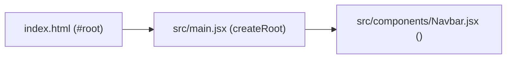
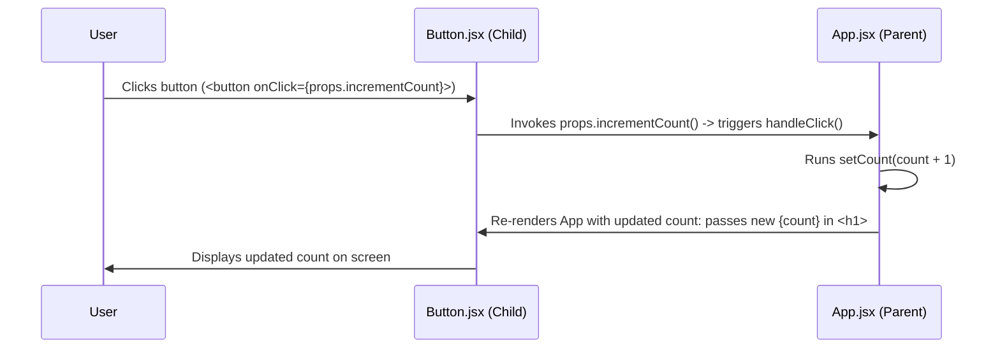

# React Learning Notes — Progressive Modules (`01react` to `04props-extra`)

Comprehensive study guide and reference covering the exact concepts implemented across the four modular practice projects in this workspace.

---

## 📌 Module 1: React Fundamentals & Bootstrapping (`01react`)

### 1. How React Starts Up (Bootstrapping Flow)
React builds Single Page Applications (SPAs) where a single HTML page is loaded, and React dynamically updates the view:



1. **`index.html`**: Contains a single empty mount element `<div id="root"></div>` and script entry `<script type="module" src="/src/main.jsx"></script>`.
2. **`main.jsx`**:
   ```jsx
   import { createRoot } from 'react-dom/client'
   import './index.css'
   import Navbar from './components/Navbar.jsx'

   createRoot(document.getElementById('root')).render(
       <Navbar />
   )
   ```
   - `createRoot(...)`: Creates the root DOM container.
   - `.render(<Navbar />)`: Injects and renders the component into the browser DOM.

### 2. Declaring Functional Components
- **Arrow Function Component** (`src/components/Navbar.jsx`):
  ```jsx
  const Navbar = () => {
    return (
      <div>
          <div>I am Navbar!</div>
      </div>
    )
  }
  export default Navbar
  ```
- **Standard Function Component** (`src/App.jsx`):
  ```jsx
  import './App.css';
  function App() {
    return (
      <>
        <p>Hello My name is React!</p>
      </>
    )
  }
  export default App
  ```

### 3. JSX & React Fragments (`<>...</>`)
- Every component must return a **single root element**.
- When you do not want to add an unnecessary extra wrapper `<div>` to the real DOM, use **React Fragments** (`<> ... </>`).

### 4. Styling Layers
- **Global CSS (`index.css`)**: Imported once in `main.jsx` for universal margin/padding reset (`* { margin: 0; padding: 0; box-sizing: border-box; }`) and viewport flex centering on `body`.
- **Component CSS (`App.css`)**: Imported directly into the component file (`import './App.css'`) for targeted styles.

---

## 📌 Module 2: Components, Props & Assets (`02comps-props-jsx`)

### 1. What are Props?
- **Props (Properties)** are arguments passed into React components from their parent.
- Data flows **one-way (unidirectional)**: from Parent (`App.jsx`) down to Child (`UserCard.jsx`).
- Props are **read-only (immutable)** inside the child component.

### 2. Passing Props from Parent (`App.jsx`)
```jsx
import UserCard from './components/UserCard'
import './App.css'
import ZoroPic from "./assets/Zoro.jpg";
import MikeyPic from "./assets/Mikey.jpg";
import GutsPic from "./assets/Guts.jpg";

function App() {
  return (
    <div className='container'>
      <UserCard name="Zoro" desc="desc1" image={ZoroPic} style={{"border-radius": "10px"}}/>
      <UserCard name="Mikey" desc="desc2" image={MikeyPic} style={{"border-radius": "10px"}}/>
      <UserCard name="Guts" desc="desc3" image={GutsPic} style={{"border-radius": "10px"}}/>
    </div>
  )
}

export default App
```

### 3. Receiving and Consuming Props (`UserCard.jsx`)
```jsx
import './UserCard.css';

const UserCard = (props) => {
  return (
    <div className='user-container' style={props.style}>
        <p id='user-name'>{props.name}</p>
        
        <p id='user-desc'>{props.desc}</p>
    </div>
  )
}

export default UserCard
```

### 4. Key Techniques in Module 2
- **Importing Local Assets**: Image files in `src/assets/` are imported as JavaScript variables (`import ZoroPic from "./assets/Zoro.jpg"`) and passed as prop values (`image={ZoroPic}`).
- **Passing Inline Style Objects**: React accepts JavaScript style objects with camelCase/quoted CSS properties (`style={{"border-radius": "10px"}}`), rendered via `style={props.style}`.

---

## 📌 Module 3: State Management with `useState` (`03usestate-hook`)

### 1. Why Normal Variables Don't Work
Regular JavaScript variables (e.g. `let count = 0; count++;`) update the variable in memory, but **do not tell React to re-render the UI**. React cannot know when to refresh the screen.

### 2. The `useState` Hook
State is data that, when changed, causes React to **re-render** the component with updated values.

```jsx
import { useState } from 'react'
import './Counter.css'

const Counter = () => {
    // 1. Declare state variable and setter function
    const [count, setCount] = useState(0);

    return (
      <div className="counter-container">
          <p id='para'>You have clicked {count} times.</p>
          {/* 2. Update state via setter on user interaction */}
          <button id='btn' onClick={() => { setCount(count + 1) }}>
              Click Me
          </button>
      </div>
    )
}

export default Counter
```

### 3. Anatomy of `useState`
- `count`: The current state value.
- `setCount`: The updater function used to modify state.
- `useState(0)`: Sets the initial value (`0`).
- **`onClick={() => setCount(count + 1)}`**: Event listener passed as an arrow function that triggers state update upon button click.

---

## 📌 Module 4: Advanced Props — Children & Function Props (`04props-extra`)

Module 4 introduces two critical advanced patterns in component composition and parent-child communication.

### Pattern 1: Passing Props as Children (`props.children`)

`props.children` allows creating **Wrapper / Container components** that render whatever nested elements are placed between their opening and closing tags.

#### 1. Wrapper Component (`Card.jsx`)
```jsx
import './Card.css'

const Card = (props) => {
  return (
    <div>
        {props.children}
    </div>
  )
}

export default Card
```

#### 2. Usage in Parent (`App.jsx`)
```jsx
<Card name="Santosh Pant">
    <h1>Best Web Dev Course</h1>
    <p>Trying to be consistent in this</p>
    <p>Will complete the course soon</p>
</Card>
```
Everything placed inside `<Card>...</Card>` is automatically available inside the component as **`props.children`**.

---

### Pattern 2: Passing Functions as Props (Callback Props)

Since props only flow downward (parent to child), how can a child component inform or trigger state changes in the parent?  
**By passing a function from the parent to the child as a prop.**

#### 1. Parent Component (`App.jsx`)
- Holds the state (`count`).
- Defines the handler function (`handleClick`).
- Passes `handleClick` as a prop (`incrementCount`) to the child `<Button />`.
- Embeds child JSX (`<h1>{count}</h1>`) inside the `<Button>` tags:

```jsx
import { useState } from 'react'
import './App.css'
import Button from './components/Button'

function App() {
  const [count, setCount] = useState(0)

  // Function defined in parent
  function handleClick() {
    setCount(count + 1);
  }

  return (
    <div>
      <Button incrementCount={handleClick} text="Click Me">
        <h1>{count}</h1>
      </Button>
    </div>
  )
}

export default App
```

#### 2. Child Component (`Button.jsx`)
- Receives `props.children` (`<h1>{count}</h1>`).
- Receives `props.text` (`"Click Me"`).
- Attaches `props.incrementCount` to the button's native `onClick` event:

```jsx
const Button = (props) => {
  return (
    <div>
        {props.children}
        <button onClick={props.incrementCount}>
            {props.text} 
        </button>
    </div>
  )
}

export default Button
```

#### Flow of Control:


---

## 📊 Summary of Concepts Across Modules

| Concept | Module | Purpose | Example |
| :--- | :--- | :--- | :--- |
| **DOM Root Mount** | `01react` | Attach React component tree to HTML | `createRoot(el).render(<Navbar />)` |
| **React Fragments** | `01react` | Return adjacent elements without extra DOM wrapper | `<> <p>Text</p> </>` |
| **Passing Props** | `02comps-props-jsx` | Pass custom data from parent to child | `<UserCard name="Zoro" desc="..." />` |
| **Asset Props** | `02comps-props-jsx` | Pass imported images as component props | `import ZoroPic ...; <UserCard image={ZoroPic} />` |
| **Style Props** | `02comps-props-jsx` | Pass dynamic inline CSS objects | `<UserCard style={{"border-radius": "10px"}} />` |
| **`useState` Hook** | `03usestate-hook` | Trigger re-renders on dynamic data change | `const [count, setCount] = useState(0)` |
| **Event Handling** | `03usestate-hook` | Handle user interactions | `onClick={() => setCount(count + 1)}` |
| **`props.children`** | `04props-extra` | Reusable wrappers with nested content | `<Card> <h1>Title</h1> </Card>` -> `{props.children}` |
| **Functions as Props** | `04props-extra` | Child triggers parent state updates | `<Button incrementCount={handleClick} />` |
