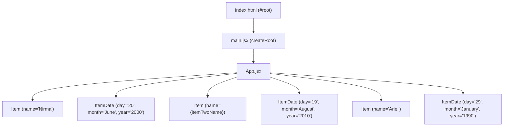

# React Learning Notes — React2 Workspace

Comprehensive study guide, architecture walkthrough, and reference notes for React fundamentals and the **DemoShopApp** project.

---

## 1. What is React?

- **Core Definition**: React is an open-source, component-based JavaScript library for building user interfaces, maintained by Meta and a vast open-source community.
- **Key Architectural Concepts**:
  - **Component-Driven Development**: UIs are constructed by assembling small, isolated, reusable building blocks called components.
  - **Declarative Paradigm**: You declare *what* the UI should look like for given data and state. React handles DOM mutations efficiently behind the scenes.
  - **Virtual DOM (VDOM)**: React maintains a lightweight representation of the real DOM in memory. When changes occur, React compares the new virtual DOM with the previous snapshot (diffing algorithm) and updates only the necessary elements in the actual DOM (reconciliation).
  - **Single Page Application (SPA)**: The browser downloads one HTML shell (`index.html`), and React dynamically renders and swaps views without reloading the page.

---

## 2. Components in React

Components are reusable functions that return JSX to describe UI elements.

### Functional Components
Modern React relies on **Functional Components** — plain JavaScript functions returning JSX:

```jsx
import './Item.css';

function Item(props) {
    const itemName = props.name;
    return (
        <p className="para">{itemName}</p>
    );
}

export default Item;
```

### Component Rules & Conventions
1. **PascalCase Naming**: Component function and file names must start with a capital letter (e.g. `Item`, `ItemDate`, `App`). Lowercase identifiers (`<div>`, `<p>`, `<span>`) are reserved for native HTML tags.
2. **Export & Import**:
   - **Default Export**: `export default Item;` (imported via `import Item from './components/Item'`).
   - **Named Export**: `export { Item };` (imported via `import { Item } from './components/Item'`).
3. **Single Root Element**: A component can return only one root element or a Fragment (`<>...</>`).

---

## 3. Understanding JSX (JavaScript XML)

JSX allows writing HTML-like syntax directly within JavaScript code. Under the hood, build tools compile JSX into standard `React.createElement()` calls.

### Core JSX Rules

| Rule | JSX Syntax | Standard HTML Equivalent | Reason / Note |
| :--- | :--- | :--- | :--- |
| **CSS Class** | `className="para"` | `class="para"` | `class` is a reserved keyword in JavaScript. |
| **Form Label For** | `htmlFor="inputId"` | `for="inputId"` | `for` is a reserved keyword in JavaScript (`for` loop). |
| **Self-Closing Tags** | `<Item />`, `<br />`, `` | ``, `<br>` | In JSX, all elements without children must explicitly close. |
| **Single Root** | `<>...</>` or `<div>...</div>` | Multiple sibling roots | JavaScript functions can return only one value/expression. |
| **Embedding Expressions** | `{expression}` | N/A | Any valid JavaScript expression enclosed in `{}` is evaluated. |

---

## 4. Props (Properties) — Passing Data Between Components

Props allow parent components to pass data down to child components, establishing a **unidirectional (top-to-bottom) data flow**.

### 1. Passing Props from Parent (`App.jsx`)
Props are passed like HTML attributes:
```jsx
// 1. Static literal strings:
<Item name="Nirma"></Item>
<ItemDate day="20" month="June" year="2000"></ItemDate>

// 2. Dynamic JavaScript variables (enclosed in curly braces {}):
const itemTwoName = "Surf Excel";
<Item name={itemTwoName}></Item>
```

### 2. Consuming Props in Child Component
Props are received as a single JavaScript object parameter:

```jsx
// Approach A: Accessing via props object
function Item(props) {
    const itemName = props.name;
    return <p className="para">{itemName}</p>;
}

// Approach B: Object destructuring directly in function parameters
function ItemDate({ day, month, year }) {
    return (
        <div className="mfg-date">
            <span>{day}</span>
            <span>{month}</span>
            <span>{year}</span>
        </div>
    );
}
```

### 3. Key Characteristics of Props
- **Read-Only (Immutable)**: A component must never modify its own `props`. All React components must act like pure functions with respect to their props.
- **Any Data Type**: Props can accept strings, numbers, booleans, arrays, objects, functions, and even other React elements (`children`).

---

## 5. Walkthrough of the DemoShopApp Codebase

```text
React2/
├── DemoShopApp/
│   ├── src/
│   │   ├── components/
│   │   │   ├── Item.jsx         # Renders item title via props.name
│   │   │   ├── Item.css         # Styles for Item
│   │   │   ├── ItemDate.jsx     # Renders manufacturing date (day, month, year)
│   │   │   └── ItemDate.css     # Styles for ItemDate
│   │   ├── App.jsx              # Parent component assembling Items & ItemDates
│   │   ├── App.css              # App container styles
│   │   ├── main.jsx             # React entry point mounting to DOM root
│   │   └── index.css            # Global resets
```

### Component Hierarchy


---

## 6. Next Steps & Advanced Concepts

1. **Props Children (`props.children`)**:
   - Passing content between opening and closing component tags: `<Card><Item ... /></Card>`.
2. **Event Handling**:
   - Adding interactive event listeners: `onClick`, `onChange`, `onSubmit`.
3. **State with `useState`**:
   - Making components interactive by storing and updating internal state.
4. **Lifting State Up**:
   - Sharing state between sibling components by managing it in their common parent.
