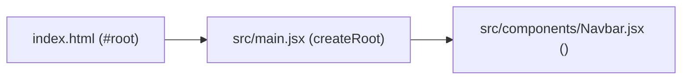

# React Learning Notes — `01react`

Study notes and conceptual walkthrough strictly reflecting the current implementation in the **`01react`** project.

---

## 1. Project Overview & Environment

- **Project Name**: `01react` (configured in `package.json`).
- **Core Dependencies**:
  - `react` (`^19.2.8`)
  - `react-dom` (`^19.2.8`)
- **Build Tool**: **Vite** (`^8.3.0`) for fast local development and HMR (Hot Module Replacement).

---

## 2. Application Bootstrapping (How React Starts)

React is a Single Page Application (SPA) library. The startup process follows a 3-step sequence:



### 1. The HTML Container (`index.html`)
The browser loads `index.html`, which contains an empty mounting element:
```html
<div id="root"></div>
<script type="module" src="/src/main.jsx"></script>
```

### 2. The DOM Mount (`src/main.jsx`)
`main.jsx` imports `createRoot` from `react-dom/client`, targets `#root`, and renders the active component:
```jsx
import { createRoot } from 'react-dom/client'
import './index.css'
// import App from './App.jsx'
import Navbar from './components/Navbar.jsx'

createRoot(document.getElementById('root')).render(
    <Navbar />
)
```
- **`createRoot`**: Creates the React root for the DOM element.
- **Rendering `<Navbar />`**: Directly renders the `Navbar` component to the screen (while `<App />` is imported/commented for alternate testing).

---

## 3. Creating Components

Components are independent, reusable pieces of UI. The project demonstrates two ways to declare functional components:

### 1. Arrow Function Component (`src/components/Navbar.jsx`)
```jsx
const Navbar = () => {
  return (
    <div>
        <div>I am Navbar!</div>
    </div>
  )
}

export default Navbar
```
- Declared using an ES6 arrow function (`const ComponentName = () => { ... }`).
- Returns nested JSX elements.
- Exported as default (`export default Navbar`), allowing it to be imported in `main.jsx`.

### 2. Standard Function Component (`src/App.jsx`)
```jsx
import './App.css';

function App() {
  return (
    <>
      <p>Hello My name is React!</p>
    </>
  )
}

export default App
```
- Declared using the standard `function` keyword (`function App() { ... }`).
- Demonstrates importing its own stylesheet (`import './App.css'`).

### Component Rules
- **PascalCase Naming**: Both `Navbar` and `App` start with an uppercase letter. Lowercase tags (`<div>`, `<p>`) are reserved for native HTML tags.
- **Export / Import**: Each component file exports its component via `export default`, which is then imported where needed via `import ComponentName from './path'`.

---

## 4. JSX & React Fragments

In React, components return JSX (JavaScript XML).

### Single Root Rule & Fragments (`<>...</>`)
Every component must return a **single root element**. If multiple elements need to be grouped without adding extra DOM nodes (like an unnecessary `<div>`), React provides **Fragments**:

```jsx
// Using React Fragment syntax (<> ... </>)
return (
  <>
    <p>Hello My name is React!</p>
  </>
)
```
- The `<>` and `</>` tags disappear when rendered to the actual browser DOM, keeping the HTML tree clean.

---

## 5. Styling Applied in the Project

The project uses two levels of CSS:

### 1. Global Reset & Layout (`src/index.css`)
Imported once in `main.jsx` to apply across the entire application:
```css
* {
    margin: 0;
    padding: 0;
    box-sizing: border-box;
    font-family: 'Times New Roman', Times, serif;
}

body {
    height: 100vh;
    display: flex;
    justify-content: center;
    align-items: center;
}
```
- **Universal Selector (`*`)**: Resets browser default margins and paddings, and sets `box-sizing: border-box`.
- **Flexbox Centering (`body`)**: Centers the rendered content both vertically and horizontally in the viewport (`100vh`).

### 2. Component-Level Styling (`src/App.css`)
Imported inside `App.jsx`:
```css
p {
    font-size: 5rem;
}
```
- Sets a large display font size for paragraph elements within `App`.

---

## 6. Current Project File Summary

| File | Type | Purpose |
| :--- | :--- | :--- |
| **`index.html`** | HTML Shell | Contains `<div id="root">` and script link to `main.jsx`. |
| **`src/main.jsx`** | Entry Point | Mounts `<Navbar />` to the DOM root using `createRoot`. |
| **`src/components/Navbar.jsx`** | Component | Arrow function component rendering `"I am Navbar!"`. |
| **`src/App.jsx`** | Component | Standard function component using Fragment `<>...</>` to render text. |
| **`src/index.css`** | Stylesheet | Global CSS reset and body viewport centering. |
| **`src/App.css`** | Stylesheet | Component styling for paragraph font size. |
