# 📘 React 2.0 Handbook & Study Notes

A curated, balanced reference guide designed for conceptual clarity, quick revision, and handwritten note-taking. Each module outlines the core problem it solves, a clean hand-drawable diagram, minimal essential code, and golden interview rules.

---

## 📚 Table of Contents
- [Module 1: Setup & Architecture (`01react`)](#module-1-setup--architecture-01react)
- [Module 2: Components, Props & Assets (`02comps-props-jsx`)](#module-2-components-props--assets-02comps-props-jsx)
- [Module 3: State Management with `useState` (`03usestate-hook`)](#module-3-state-management-with-usestate-03usestate-hook)
- [Module 4: Advanced Props — Children & Callbacks (`04props-extra`)](#module-4-advanced-props--children--callbacks-04props-extra)
- [Module 5: State Lifting & Sibling Synchronization (`05state-lifting`)](#module-5-state-lifting--sibling-synchronization-05state-lifting)
- [Module 6: Conditional Rendering Patterns (`06conditional-rendering`)](#module-6-conditional-rendering-patterns-06conditional-rendering)
- [Module 7: Event Handling & Synthetic Events (`07event-handling`)](#module-7-event-handling--synthetic-events-07event-handling)
- [Module 8: The `useEffect` Hook & Lifecycles (`08useEffect-hook`)](#module-8-the-useeffect-hook--lifecycles-08useeffect-hook)
- [Module 9: Global State with Context API (`09useContext-hook`)](#module-9-global-state-with-context-api-09usecontext-hook)
- [Module 10: Client-Side Routing with React Router (`10react-router`)](#module-10-client-side-routing-with-react-router-10react-router)
- [Module 11: High-Performance Forms with React Hook Form (`11react-hook-form`)](#module-11-high-performance-forms-with-react-hook-form-11react-hook-form)
- [📊 Quick Revision Cheat Sheet](#-quick-revision-cheat-sheet)

---

## Module 1: Setup & Architecture (`01react`)

### 1. Core Purpose
React is a component-based library for building user interfaces. Vite bundles the project and mounts the component tree into a single HTML entry point (`index.html`) using React 18's `createRoot`.

### 2. Handbook Diagram
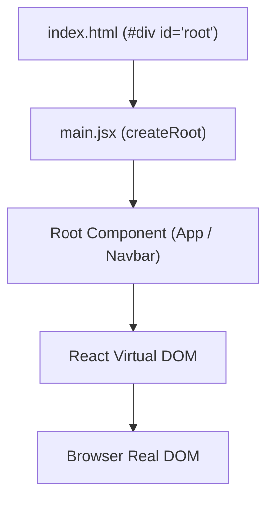

### 3. Essential Syntax & Patterns
```jsx
// src/main.jsx - Entry Point
import { createRoot } from 'react-dom/client'
import './index.css'
import Navbar from './components/Navbar.jsx'

createRoot(document.getElementById('root')).render(
  <Navbar />
)
```

```jsx
// src/components/Navbar.jsx - Functional Component
const Navbar = () => {
  return (
    <>
      <nav>I am Navbar!</nav>
    </>
  )
}
export default Navbar
```

### 4. Golden Rules for Your Handbook
* **Component Naming**: Component functions must always start with a **Capital Letter** (e.g. `Navbar`, `App`).
* **Single Root / Fragments**: Every component must return one single root element. Use React Fragments (`<>...</>`) to group elements without injecting unnecessary extra `<div>` tags into the DOM.
* **CSS Scopes**: `index.css` applies global resets (`margin: 0`, centering); `App.css` contains component-specific styles.

---

## Module 2: Components, Props & Assets (`02comps-props-jsx`)

### 1. Core Purpose
Props (Properties) allow data to pass from a parent component down to child components. Data flows in a **strict one-way (unidirectional)** direction, making UI state predictable.

### 2. Handbook Diagram
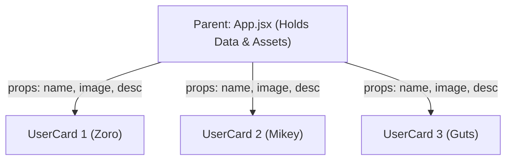

### 3. Essential Syntax & Patterns
```jsx
// Parent (src/App.jsx) - Passing Props & Assets
import UserCard from './components/UserCard'
import ZoroPic from "./assets/Zoro.jpg"

function App() {
  return (
    <div className='container'>
      <UserCard 
        name="Zoro" 
        desc="Swordsman" 
        image={ZoroPic} 
        style={{ borderRadius: "10px" }} 
      />
    </div>
  )
}
export default App
```

```jsx
// Child (src/components/UserCard.jsx) - Receiving Props
const UserCard = (props) => {
  return (
    <div className='user-container' style={props.style}>
      <p id='user-name'>{props.name}</p>
      
      <p id='user-desc'>{props.desc}</p>
    </div>
  )
}
export default UserCard
```

### 4. Golden Rules for Your Handbook
* **Props are Read-Only (Immutable)**: A child component must never modify its received `props`.
* **Importing Images**: Local images in `src/assets` must be imported as JavaScript variables (`import pic from './assets/pic.jpg'`) before being passed as prop values.
* **Inline Styles**: Passed as JavaScript objects with camelCase properties (e.g. `style={{ borderRadius: "10px" }}`).

---

## Module 3: State Management with `useState` (`03usestate-hook`)

### 1. Core Purpose
Standard JavaScript variables (e.g. `let count = 0`) do not inform React when their values change. `useState` creates reactive state variables that automatically trigger a **component re-render** whenever updated via their setter function.

### 2. Handbook Diagram
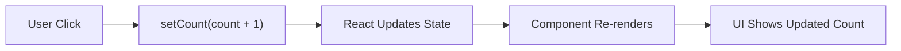

### 3. Essential Syntax & Patterns
```jsx
// src/components/Counter.jsx
import { useState } from 'react'

const Counter = () => {
  // 1. Declare state and setter with initial value (0)
  const [count, setCount] = useState(0);

  return (
    <div className="counter-container">
      <p>You have clicked {count} times.</p>
      {/* 2. Update state via setter */}
      <button onClick={() => setCount(count + 1)}>
        Click Me
      </button>
    </div>
  )
}
export default Counter
```

### 4. Golden Rules for Your Handbook
* **Never Mutate Directly**: Writing `count = count + 1` ❌ fails because React will not know to re-render. Always call `setCount(count + 1)` ✅.
* **Hook Rules**: Hooks must only be called at the **top level** of functional components, never inside loops, conditions, or nested functions.

---

## Module 4: Advanced Props — Children & Callbacks (`04props-extra`)

### 1. Core Purpose
* **`props.children`**: Enables wrapper/container components that project whatever nested JSX is placed between their tags.
* **Callback Props**: Allows a child component to communicate events up to its parent by executing a function received as a prop.

### 2. Handbook Diagram
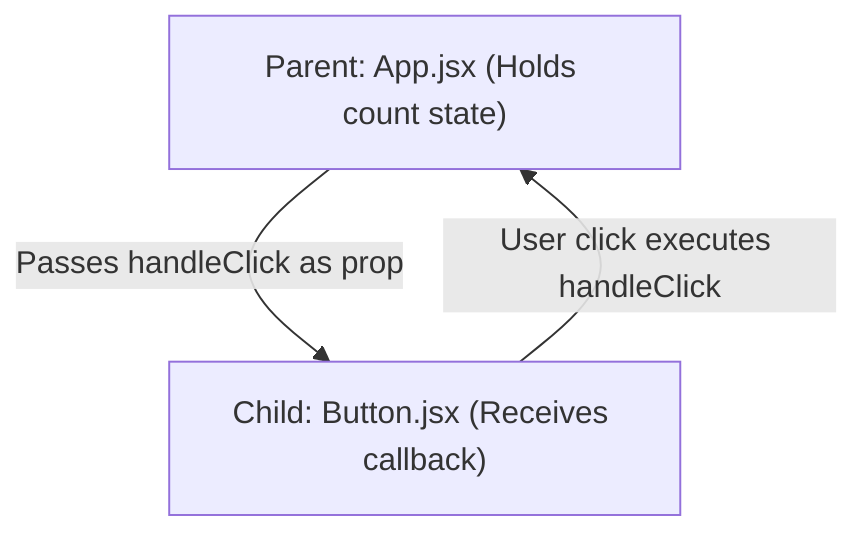

### 3. Essential Syntax & Patterns
```jsx
// Pattern 1: Container Component with props.children
const Card = (props) => {
  return <div className="card-box">{props.children}</div>
}

// Usage in App.jsx:
<Card>
  <h1>Course Title</h1>
  <p>Enclosed text rendered via props.children</p>
</Card>
```

```jsx
// Pattern 2: Passing Functions as Props (Callback Props)
// Parent: App.jsx
function App() {
  const [count, setCount] = useState(0);
  function handleClick() { setCount(count + 1); }

  return <Button incrementCount={handleClick} text="Click Me" />
}

// Child: Button.jsx
const Button = (props) => {
  return (
    <button onClick={props.incrementCount}>
      {props.text}
    </button>
  )
}
```

### 4. Golden Rules for Your Handbook
* **Content Projection**: Use `props.children` when building reusable cards, modals, dialogs, and layout containers.
* **Child-to-Parent Communication**: React does not allow data to flow upward directly; parents pass a function, and the child calls that function with data as arguments.

---

## Module 5: State Lifting & Sibling Synchronization (`05state-lifting`)

### 1. Core Purpose
Sibling components cannot communicate directly. When two or more siblings need to share or synchronize the same data, you **lift the state up** to their closest common ancestor.

### 2. Handbook Diagram
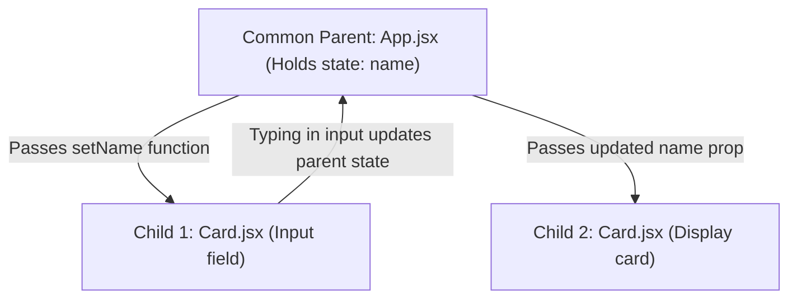

### 3. Essential Syntax & Patterns
```jsx
// Parent (src/App.jsx) - Single Source of Truth
import Card from "./components/Card"
import { useState } from "react"

function App() {
  const [name, setName] = useState('');

  return (
    <div>
      <Card title="Card 1" name={name} setName={setName}/>
      <Card title="Card 2" name={name} setName={setName}/>
    </div>
  )
}
export default App
```

```jsx
// Child (src/components/Card.jsx)
const Card = (props) => {
  return (
    <div>
      <input type="text" onChange={(e) => props.setName(e.target.value)} />
      <p>{props.title} value: {props.name}</p>
    </div>
  )
}
export default Card
```

### 4. Golden Rules for Your Handbook
* **Single Source of Truth**: State lives in one common place (`App.jsx`), avoiding duplicate, out-of-sync variables.
* **Two-Way Synchronization**: Typing into `Card 1` updates the parent state, which immediately re-renders and reflects in `Card 2`.

---

## Module 6: Conditional Rendering Patterns (`06conditional-rendering`)

### 1. Core Purpose
Conditionally display different UI components or elements depending on state variables (such as authentication or loading status).

### 2. Handbook Diagram
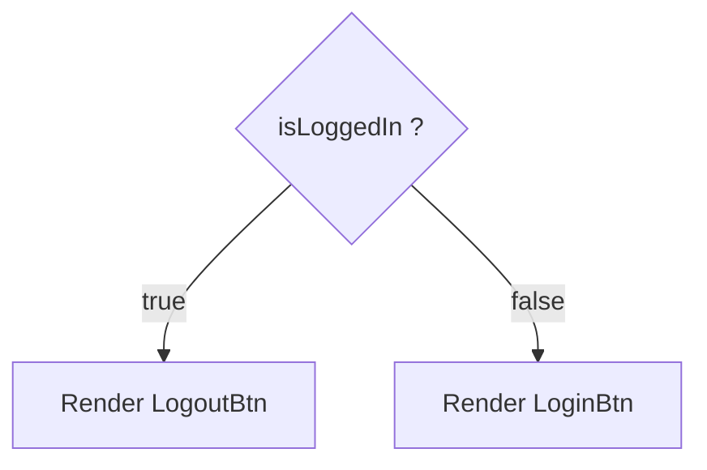

### 3. The 4 Core Patterns Cheat Sheet
```jsx
// 1. Early Return (Guard Clause)
if (!isLoggedIn) {
  return <LoginBtn />
}
return <LogoutBtn />

// 2. Logical AND Operator (&&) - Render element or nothing
{isLoggedIn && <LogoutBtn />}

// 3. Ternary Operator (? :) - Clean inline binary toggle
{isLoggedIn ? <LogoutBtn /> : <LoginBtn />}

// 4. Classic if-else block
let btn;
if (isLoggedIn) { btn = <LogoutBtn />; } else { btn = <LoginBtn />; }
return <div>{btn}</div>
```

### 4. Golden Rules for Your Handbook
* **Best for Toggles**: Use **Ternary (`? :`)** for inline choices between two different components.
* **Best for Show/Hide**: Use **Logical AND (`&&`)** when you want to render something only if a condition is true.
* **Best for Guards**: Use **Early Return** at the top of a component for loading spinners or unauthorized states.

---

## Module 7: Event Handling & Synthetic Events (`07event-handling`)

### 1. Core Purpose
React wraps native browser DOM events in a normalized wrapper called **`SyntheticEvent`**. This ensures identical event behavior across all browsers (Chrome, Safari, Firefox, Edge).

### 2. Handbook Diagram
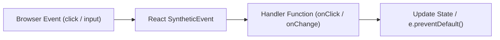

### 3. Essential Syntax & Patterns
```jsx
function App() {
  // 1. Passing function reference
  function handleClick() {
    alert("Button clicked!");
  }

  // 2. Input event reading value
  function handleInputChange(e) {
    console.log("Current text:", e.target.value);
  }

  // 3. Form submit with preventDefault
  function handleSubmit(e) {
    e.preventDefault(); // Prevents browser page reload
    alert("Form submitted safely!");
  }

  return (
    <form onSubmit={handleSubmit}>
      {/* Correct: function reference without parentheses */}
      <button type="button" onClick={handleClick}>Click Me</button>
      
      <input type="text" onChange={handleInputChange} />
      <button type="submit">Submit</button>
    </form>
  )
}
export default App
```

### 4. Golden Rules for Your Handbook
* **Reference vs Call**: Always pass the function reference (`onClick={handleClick}` ✅). Never write `onClick={handleClick()}` ❌ (this calls the function immediately on render!).
* **Form Submission**: Always call `e.preventDefault()` on form submit handlers to prevent the browser from reloading the entire page.

---

## Module 8: The `useEffect` Hook & Lifecycles (`08useEffect-hook`)

### 1. Core Purpose
Handles **side effects** (operations outside React's pure rendering flow), such as API fetching, setting timers, window event listeners, and manual cleanup.

### 2. Handbook Diagram
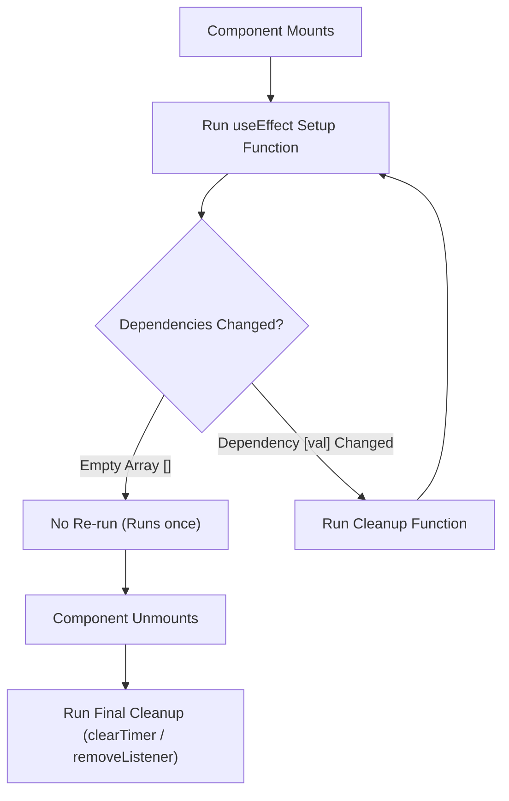

### 3. The 4 Dependency Rules Cheat Sheet
```jsx
import { useEffect, useState } from 'react'

// 1. No dependency array -> Runs after EVERY single render
useEffect(() => {
  console.log("Runs on every render");
});

// 2. Empty array [] -> Runs ONLY ONCE on mount (Ideal for API fetching)
useEffect(() => {
  fetch('https://api.example.com/data')
    .then(res => res.json())
    .then(data => setData(data));
}, []);

// 3. With dependencies [count] -> Runs on mount AND when count changes
useEffect(() => {
  console.log("Count changed to:", count);
}, [count]);

// 4. With Cleanup function -> Runs before re-running effect & on unmount
useEffect(() => {
  const timer = setInterval(() => setSec(s => s + 1), 1000);
  return () => clearInterval(timer); // Prevents memory leaks
}, []);
```

### 4. Golden Rules for Your Handbook
* **Always Clean Up**: Timers (`setInterval`), web sockets, and event listeners (`addEventListener`) must return a cleanup function to avoid memory leaks.
* **Data Fetching**: Put initial API calls inside `useEffect(..., [])` with an empty array so they run once.

---

## Module 9: Global State with Context API (`09useContext-hook`)

### 1. Core Purpose
Eliminates **Prop Drilling** (the tedious passing of props down through intermediary components that do not need them). Provides direct global access to state anywhere in the component tree.

### 2. Handbook Diagram
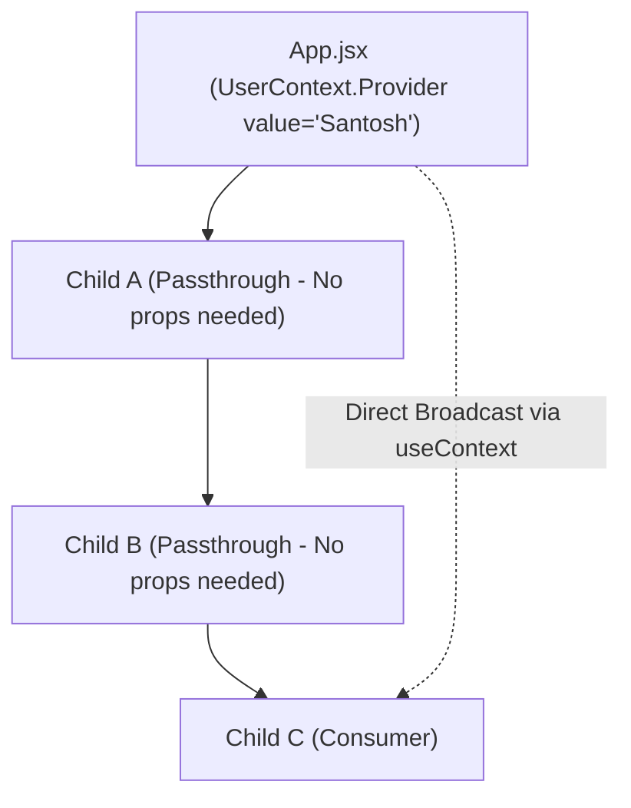

### 3. The 3-Step Recipe
```jsx
// Step 1: Create Context in App.jsx (or separate file)
import { createContext, useState } from 'react'
export const UserContext = createContext();

function App() {
  const [user, setUser] = useState({ name: "Santosh" });

  return (
    // Step 2: Wrap children in Provider & pass value
    <UserContext.Provider value={user}>
      <ChildA />
    </UserContext.Provider>
  )
}
export default App
```

```jsx
// Step 3: Consume Context directly in ChildC.jsx
import { useContext } from 'react'
import { UserContext } from '../App'

const ChildC = () => {
  const user = useContext(UserContext); // Direct access
  return <h1>Hello, {user.name}</h1>
}
export default ChildC
```

### 4. Golden Rules for Your Handbook
* **Create, Provide, Consume**: 1. `createContext()`, 2. `<Context.Provider value={...}>`, 3. `useContext(Context)`.
* **Use Case**: Best for global data like current user session, UI themes (dark/light), and app settings.

---

## Module 10: Client-Side Routing with React Router (`10react-router`)

### 1. Core Purpose
Enables **Single Page Applications (SPAs)** where route changes dynamically swap views without full browser reloads. Supports dynamic params, nested layouts, and 404 handling.

### 2. Handbook Diagram
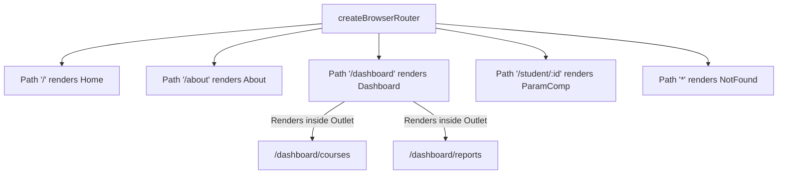

### 3. Essential Syntax & Patterns
```jsx
// src/App.jsx - Modern Router Configuration
import { createBrowserRouter, RouterProvider } from 'react-router-dom'
import Home from './components/Home'
import Dashboard from './components/Dashboard'
import Courses from './components/Courses'
import ParamComp from './components/ParamComp'
import NotFound from './components/NotFound'

const router = createBrowserRouter([
  { path: '/', element: <Home /> },
  { 
    path: '/dashboard', 
    element: <Dashboard />,
    children: [
      { path: 'courses', element: <Courses /> } // Renders in <Outlet />
    ]
  },
  { path: '/student/:id', element: <ParamComp /> },
  { path: '*', element: <NotFound /> } // 404 Wildcard
]);

function App() {
  return <RouterProvider router={router} />
}
export default App
```

```jsx
// Core Router Hooks & Components Quick Reference:
// 1. Active Link Styling:
<NavLink to="/about" className={({ isActive }) => isActive ? "active-link" : ""}>About</NavLink>

// 2. Programmatic Navigation:
const navigate = useNavigate();
navigate('/dashboard');

// 3. Dynamic URL Params (/student/:id):
const { id } = useParams();

// 4. Nested Route Viewport inside Dashboard.jsx:
<Outlet />
```

### 4. Golden Rules for Your Handbook
* **No Reloads**: Use `<NavLink>` or `<Link>` instead of `<a href="...">` to prevent full browser refreshes.
* **Nested Viewports**: Parent components must render `<Outlet />` for child routes defined under `children` to display.
* **Dynamic Params**: Colons denote variable path segments (`:id`), extracted using `useParams()`.

---

## Module 11: High-Performance Forms with React Hook Form (`11react-hook-form`)

### 1. Core Purpose
Traditional forms with `useState` and `onChange` re-render the **entire component on every single keystroke**. **React Hook Form** uses **uncontrolled inputs via React `ref`s**, providing zero-rerender typing, built-in validation rules, and automatic error handling.

### 2. Handbook Diagram
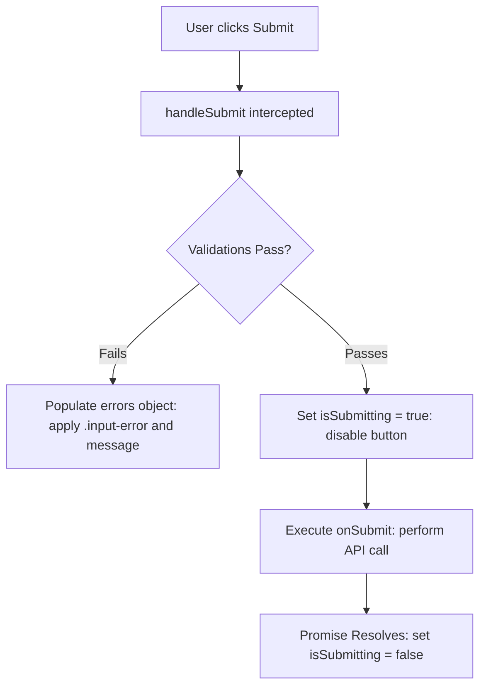

### 3. Essential Syntax & Patterns
```jsx
// src/App.jsx
import { useForm } from "react-hook-form"
import './App.css'

function App() {
  const {
    register,
    handleSubmit,
    formState: { errors, isSubmitting }
  } = useForm();

  async function onSubmit(data) {
    await new Promise(r => setTimeout(r, 2000)); // Simulate API delay
    console.log("Form Submitted:", data);
  }

  return (
    <form onSubmit={handleSubmit(onSubmit)}>
      {/* 1. Register input with validation constraints */}
      <input 
        className={errors.firstname ? 'input-error' : ''}
        {...register('firstname', { 
          required: "First name is required", 
          minLength: { value: 3, message: "Min 3 characters" } 
        })} 
      />
      {/* 2. Display field error message */}
      {errors.firstname && <p className="error-msg">{errors.firstname.message}</p>}

      {/* 3. Regex pattern constraint */}
      <input 
        {...register('lastname', { 
          pattern: { value: /^[A-Za-z]+$/i, message: "Letters only" } 
        })} 
      />
      {errors.lastname && <p className="error-msg">{errors.lastname.message}</p>}

      {/* 4. Disable submit button during active submission */}
      <input 
        type="submit" 
        disabled={isSubmitting} 
        value={isSubmitting ? "Submitting..." : "Submit"} 
      />
    </form>
  )
}
export default App
```

### 4. Golden Rules for Your Handbook
* **Zero Typing Re-renders**: `register` connects inputs directly through `ref`s without triggering component state updates on each keystroke.
* **Auto-Validation**: `handleSubmit` validates all constraints *before* calling your `onSubmit` function. If invalid, `onSubmit` is never executed.
* **Prevent Duplicate Submits**: Use `formState.isSubmitting` to disable the submit button during asynchronous API requests.

---

## 📊 Quick Revision Cheat Sheet

| Module | Core Topic | Primary Hook / API | One-Line Memory Hook |
| :--- | :--- | :--- | :--- |
| **01** | **Setup & Architecture** | `createRoot().render()` | Injects root component into single HTML DOM container. |
| **02** | **Components & Props** | `props.name`, `props.image` | Immutable data flowing strictly top-down (Parent $
ightarrow$ Child). |
| **03** | **State Management** | `useState(init)` | Reactive variables whose setters trigger component re-render. |
| **04** | **Advanced Props** | `props.children`, callbacks | Container wrappers & child-to-parent event notification. |
| **05** | **State Lifting** | Common Parent State | Lift state up to closest ancestor to sync sibling components. |
| **06** | **Conditional UI** | `? :`, `&&`, early return | Render dynamic layouts based on state conditions. |
| **07** | **Event Handling** | `SyntheticEvent`, `preventDefault` | Cross-browser normalized events; pass function reference without `()`. |
| **08** | **Side Effects** | `useEffect(fn, [deps])` | Post-render lifecycle: API calls, timers, and unmount cleanups. |
| **09** | **Global Context** | `createContext`, `useContext` | Eliminate prop drilling by broadcasting state directly to consumers. |
| **10** | **Client Routing** | `createBrowserRouter`, `<Outlet />` | SPAs without reload: active links, nested routes, and dynamic `:id`. |
| **11** | **Form Management** | `useForm`, `register`, `handleSubmit` | Uncontrolled high-performance forms with built-in schema validation. |
